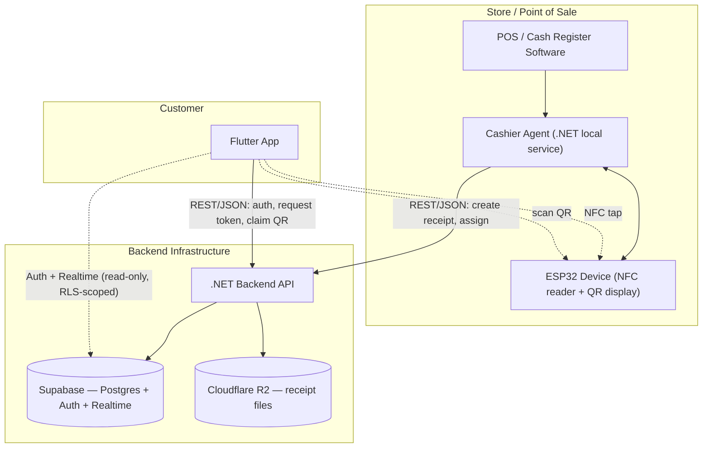
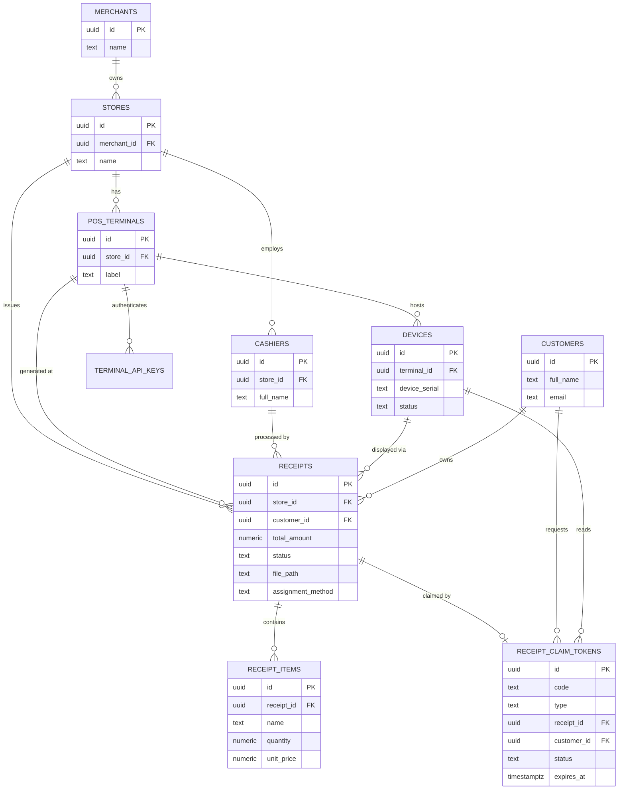
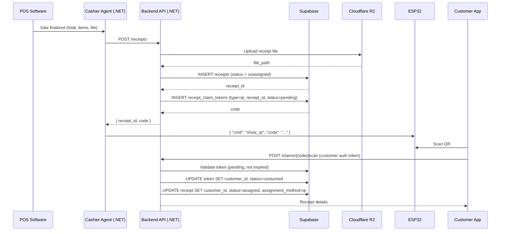
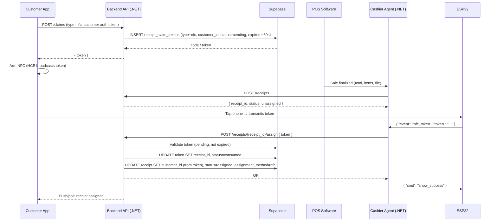
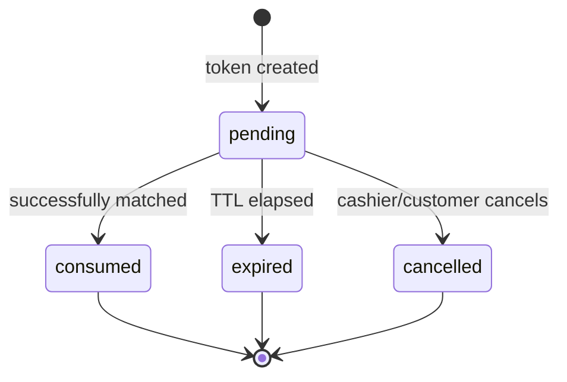
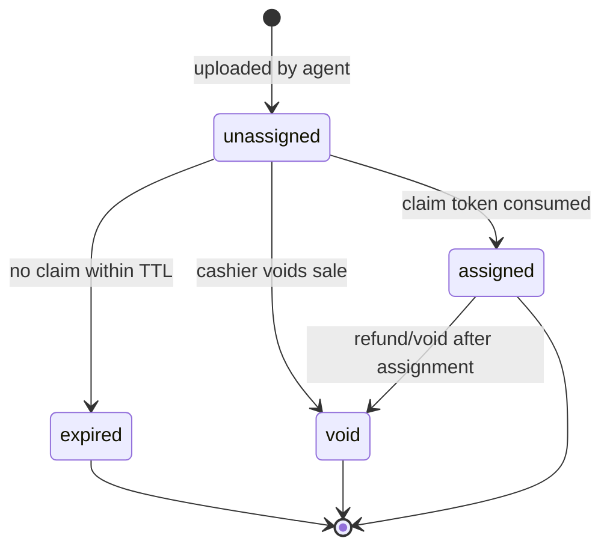

# Digital Receipt System — Design Document

## 1. How the pieces fit together

- **ESP32 device** — sits at the register, shows the QR code and handles the NFC tap. Already built, controlled via your JSON command layer.
- **Cashier Agent (.NET, on the POS PC)** — bridges the POS software, the ESP32, and your backend API.
- **Backend API (.NET)** — owns all writes: creating receipts, issuing claim tokens, assigning receipts to customers.
- **Supabase (Postgres + Auth + Realtime)** — the database, plus customer authentication.
- **Cloudflare R2** — stores the actual receipt files (PDF/image); the database only stores the object key/path.
- **Flutter app** — customer-facing. Logs in via Supabase Auth, scans QR / arms NFC, views assigned receipts.

The core idea: **QR and NFC are the same mechanism** — a short-lived, single-use "claim token" — just filled in from opposite ends:

| | Created by | At creation | Filled in later by |
|---|---|---|---|
| **QR** | Backend, when receipt is made | `receipt_id` set, `customer_id` empty | App, on scan → sets `customer_id` |
| **NFC** | Backend, when customer taps "Ready" | `customer_id` set, `receipt_id` empty | Agent, after the tap → sets `receipt_id` |

Either way, once both `receipt_id` and `customer_id` are present and the token is marked `consumed`, the receipt itself is updated to `status = assigned`.

## 2. Architecture

## 3. Entity-relationship diagram

## 4. QR flow (sequence)

## 5. NFC flow (sequence)

## 6. State diagrams

**Claim token**

**Receipt**

## 7. Suggested backend endpoints

| Endpoint | Caller | Purpose |
|---|---|---|
| `POST /api/receipts` | Agent | Upload receipt file to R2, insert receipt (+ QR claim token if applicable) |
| `POST /api/claims` | App | Request an NFC token before tapping |
| `POST /api/claims/{code}/scan` | App | Claim a receipt by scanning its QR |
| `POST /api/receipts/{id}/assign` | Agent | Complete NFC assignment using the tapped token |
| `GET /api/customers/me/receipts` | App | List the logged-in customer's receipts |
| `GET /api/receipts/{id}/file` | App | Get a short-lived signed R2 URL for the receipt file |

## 8. Security notes

- **Token codes**: generate with a cryptographically random source (not sequential), e.g. 8–10 char base32. Enforce uniqueness at the DB level (already done via `unique` on `code`).
- **TTL**: keep it short — a few minutes for QR (customer has to walk up and scan), ~30–60s for NFC (tap happens almost immediately after arming).
- **Single-use**: the `status` transition `pending → consumed` should happen inside one DB transaction so two near-simultaneous claims on the same code can't both succeed.
- **Service role key**: only the .NET backend holds it. The Flutter app talks to Supabase with the anon/authenticated key, scoped by the RLS policies in `schema.sql`, and never writes receipts or tokens directly.
- **R2 files**: keep the bucket private; the backend issues short-lived signed URLs when the app requests a receipt's file, rather than storing public URLs.
- **Terminal auth**: the Agent (and by extension the ESP32 behind it) authenticates to the backend using the `terminal_api_keys` table — a compromised register shouldn't be able to act as an arbitrary terminal.

## 9. Open questions worth deciding early

- Do you want a hard **cap on unclaimed receipts** (e.g. auto-void after N hours) for storage/cleanup?
- Should a customer be able to **cancel** an armed NFC session from the app (before tapping)?
- Do you need **partial refunds/voids** reflected on an already-assigned receipt, or is void always all-or-nothing?
